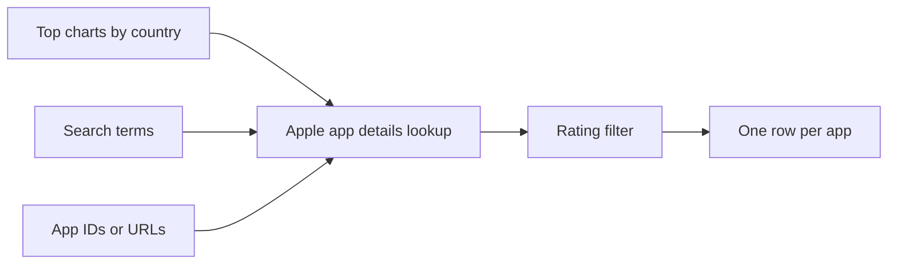

# App Store Scraper: Top Charts, Search and App Details

[](https://apify.com/Turboextract/app-store-charts-apps)
[](LICENSE)
[](#pricing)

**Get Apple App Store top free and top paid charts for any country, search apps by keyword, and look up any app by ID.** Each app comes with rank, developer, developer website, category, price, rating, rating count, version, release and update dates, size and languages. Uses Apple's official public feeds, so there is no login.

In one test, the actor returned 436 apps from the top free and top paid charts in the US and UK, plus a keyword search, with full details for each.

**Try it now →** [apify.com/Turboextract/app-store-charts-apps](https://apify.com/Turboextract/app-store-charts-apps)

---

## Why this exists

- The App Store shows charts and app details one screen at a time, with no export.
- Chart ranks change daily and differ by country.
- App intelligence platforms charge hundreds a month.
- Developer websites are on every app page, but only one app at a time.

---

## Who this is for

- **App marketers and ASO teams** tracking chart ranks and competitors
- **Mobile agencies and dev shops** finding app developers to pitch, with their websites
- **Investors and analysts** watching fast-rising apps by country
- **Product teams** comparing ratings, pricing and update cadence
- **Researchers** building app market datasets

---

## What you get

```json
{
  "source": "chart",
  "chart": "top-free",
  "rank": 1,
  "country": "us",
  "appId": 6741796873,
  "name": "TikTok Pro - Events",
  "bundleId": "com.ss.iphone.ugc.tiktok.pro",
  "url": "https://apps.apple.com/us/app/tiktok-pro-events/id6741796873",
  "developer": "TikTok Ltd.",
  "developerUrl": "https://apps.apple.com/us/developer/tiktok-ltd/id1322881000",
  "developerWebsite": "https://www.tiktok.com",
  "category": "Entertainment",
  "price": 0,
  "rating": 4.83,
  "ratingCount": 105254,
  "version": "47.8.0",
  "releasedAt": "2026-06-03T07:00:00Z",
  "updatedAt": "2026-11-18T03:04:27Z",
  "sizeMb": 1030.6,
  "contentRating": "12+",
  "languages": ["EN", "FR", "DE", "..."]
}
```

---

## How it works



---

## Quick start

1. Click **Try for free**.
2. Pick **Top charts**, add **Search terms** like `budget planner`, or paste **App IDs or URLs**.
3. Optional: add **Countries** like `us`, `gb` or `de`, and set **Minimum rating count**.
4. Click **Start**, then export to CSV, JSON or Google Sheets.

### API

```bash
curl -X POST "https://api.apify.com/v2/acts/Turboextract~app-store-charts-apps/run-sync-get-dataset-items?token=YOUR_TOKEN" \
  -H "Content-Type: application/json" \
  -d '{
    "charts": ["top-free", "top-paid"],
    "countries": ["us", "gb", "de"],
    "chartLimit": 100
  }'
```

### Python

```python
from apify_client import ApifyClient

client = ApifyClient("YOUR_TOKEN")
run = client.actor("Turboextract/app-store-charts-apps").call(run_input={
    "searchTerms": ["habit tracker", "budget planner"],
    "minRatingCount": 100,
})
for app in client.dataset(run["defaultDatasetId"]).iterate_items():
    print(app["name"], app["developer"], app["developerWebsite"], app["ratingCount"])
```

---

## Input fields

| Field | Default | What it does |
|---|---|---|
| `charts` | – | Top free and/or top paid apps |
| `countries` | us | App Store country codes |
| `chartLimit` | 25 | Apps per chart, up to 100 |
| `searchTerms` | – | Find apps by keyword |
| `appIds` | – | App IDs or App Store URLs |
| `maxSearchResults` | 50 | Per search term, up to 200 |
| `minRatingCount` | 0 | Skip apps with fewer ratings |
| `includeDescription` | false | Adds description and release notes |
| `maxResults` | 500 | Total cap per run |

---

## Pricing

**$0.003 per app delivered.** 1,000 apps cost $3.

| Option | 1,000 apps |
|---|---|
| **App Store Scraper** | **$3**, charts, search and details in one actor |
| Other App Store actors on Apify | $2 to $3, some with start fees |
| App intelligence platforms | $100+ a month |

---

## Common use cases

- **Chart tracking**: daily ranks by country for your app and competitors
- **Developer lead lists**: chart and search results with developer websites
- **Market research**: ratings, prices and categories for a niche
- **Release monitoring**: `updatedAt` and `version` for apps you watch
- **Localization research**: which languages top apps support
- **Category benchmarks**: average rating and price for the top 100 in a country

---

## Tips for best results

- Run the same input on a schedule and compare `rank` to see who is climbing.
- `developerWebsite` is the seller's own site. Pair it with an enrichment actor for contacts.
- Apple's 100-app chart sometimes times out. The actor then falls back to a smaller list instead of failing.

---

## Pairs well with

- [Chrome Web Store Scraper](https://apify.com/Turboextract/chrome-extension-leads): browser extensions and their developers
- [B2B Lead Enrichment Pipeline](https://apify.com/Turboextract/b2b-lead-enrichment-pipeline): contacts from developer websites
- [Steam Store Scraper](https://apify.com/Turboextract/steam-games-prices): the same view for PC games

---

## FAQ

**Do I need an Apple developer account?** No. The actor uses Apple's public charts feed and search API.

**Does it include reviews?** No. It returns ratings and rating counts per app, not review text.

**Which countries work?** Any App Store country, by two-letter code.

**How fresh are the charts?** Apple updates its charts feed several times a day.

**Is it legal?** It uses Apple's official public feeds. Follow Apple's terms and privacy laws when you contact developers.

---

## SEO keywords

App Store scraper, App Store API, iOS app scraper, App Store top charts, scrape App Store apps, iTunes Search API, app developer leads, ASO competitor tracking, app ranking tracker, Apple app data

---

## Support

- Actor page: https://apify.com/Turboextract/app-store-charts-apps
- Issues and questions: open an issue in this repo
- Community Discord: https://discord.gg/8SrXSCpvgj

Built and maintained by [Turboextract](https://apify.com/Turboextract) on the Apify platform.

---

## License

The documentation and examples in this repository are MIT licensed. The actor itself runs on the Apify platform.
